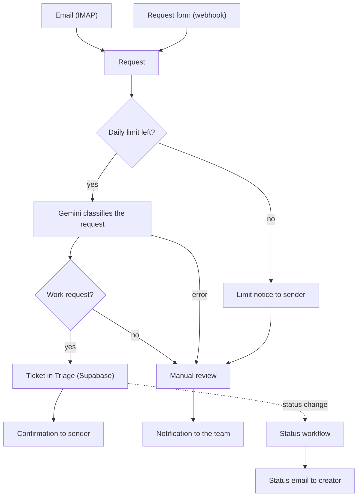

# Join

Join is a Kanban-style task management app for organizing work, assigning tasks to contacts, and tracking progress. Team members can manage tasks across a board and review progress in a summary view. The app is built with Angular and uses Supabase for backend data and authentication.

The **Issue Collector** extends Join with an AI-powered intake for stakeholder requests. Stakeholders send feature requests by form or by email. n8n and AI (Google Gemini) turn them into tickets in the "Triage" column and keep the creators informed about status changes.

**Live demo:** [join.anne-manthey.de](https://join.anne-manthey.de/)

## Credits

Join was originally built as a group project by Kristina Starovoit, Anne Manthey, and Anja-Isabella Schulz. It covers the Kanban board, contacts, summary dashboard, and authentication.

The Issue Collector (Triage column, request form and stakeholder pages, n8n workflows, AI classification, status notifications, and the related database changes) was developed afterwards by Anne Manthey. 

## Features

- Kanban board with task status columns and drag-and-drop
- "Triage" column as the backlog for all new tasks
- Task creation and editing, including priority, category, subtasks, and contact assignments
- Contact management and task assignment
- Summary dashboard for task progress
- Public stakeholder Issue Collector: requests by form (name, email, subject, request) or by email
- AI classification of requests (category, title, priority, deadline) and automatic ticket creation
- Daily limit of 10 automatically processed requests, shown on the stakeholder page
- Creator shown in the task details (internal member or external stakeholder), with an "AI-generated ticket" badge
- Email notifications for external creators when their ticket moves to another column
- Authentication and registration for team members

## Tech stack

- Angular 22 with standalone components and Signals
- Supabase for backend data and authentication
- n8n (self-hosted with Docker and Caddy) for the Issue Collector workflows
- Google Gemini API for classifying requests
- Vitest for unit tests

## Quickstart

### Prerequisites

- Node.js
- npm 11.12.1 (pinned in `package.json`)
- A Supabase project (see "Database" below)

### Setup

1. Install dependencies:

```bash
   npm install
```

2. Configure the app by copying `src/environments/environment.template.ts` to `src/environments/environment.ts` and setting the project URL, the publishable key, and the n8n webhook of the request form:

```ts
   export const environment = {
     supabaseUrl: 'YOUR_SUPABASE_URL',
     supabaseKey: 'YOUR_SUPABASE_PUBLISHABLE_KEY',
     requestWebhookUrl: 'YOUR_N8N_WEBHOOK_URL',
   };
```

   The environment file is ignored by Git; do not commit credentials.

3. Start the development server:

```bash
   npm start
```

   The app is served at `http://localhost:4200/`.

### Database

Run `supabase/schema.sql` first, then `supabase/schema-additions.sql` (part 1 on its own, then part 2). The additions create the Triage status, the creator columns, the daily usage counter and its functions.

## Usage

- `/` — welcome page with links to stakeholder requests and team login
- `/stakeholder` — stakeholder information page
- `/request` — Issue Collector form
- `/privacy-policy` and `/legal-notice` — legal pages
- `/login` and `/register` — team member authentication
- `/board`, `/contacts`, and `/summary` — task management pages for authenticated team members

## Issue Collector

### Try it

1. Open `/request` and send a request, or send an email to `join-requests@anne-manthey.de`.
2. The request is classified by AI and appears as a ticket in the "Triage" column. You receive a confirmation email.
3. When a team member moves the ticket to another column, you receive a status email.
4. After 10 requests per day, no more tickets are created automatically. Senders get a notice and the team reviews the request manually.

### How it works



Emails are moved to the mailbox folder `done` after a ticket was created and to `review` in all other cases. Requests that need a manual look also trigger a notification email to the team.

### n8n workflows

The workflows are exported to `n8n/workflows/`:

- `join-issue-collector.json` — email and form intake, limit check, AI classification, ticket creation, confirmation
- `join-status-notifications.json` — status emails after a Supabase database webhook
- `join-supabase-keep-alive.json` — daily request that keeps the free Supabase project from pausing

The server setup (n8n and Caddy with HTTPS, only `/webhook/*` is public) is in `n8n/server/`. The environment template is `n8n/.env.template`.

1. Start the server with `docker compose up -d` in a folder containing `docker-compose.yml`, `Caddyfile` and `.env`.
2. Import the three workflows in the n8n editor.
3. Create the credentials listed in `n8n/.env.template`: `join-imap`, `join-imap-community` (community package `n8n-nodes-imap`, needed for moving mails), `join-smtp`, `join-supabase`, `join-ai`, and `join-webhook-secret` (header `x-webhook-secret`).
4. In Supabase, create a database webhook `join_status_notifications` on `tasks` (event: update) that sends a POST to `https://<n8n-host>/webhook/join-status` with the header `x-webhook-secret`.

### Configuration

- **Daily limit:** `DAILY_REQUEST_LIMIT` in the frontend and `p_limit` in the n8n node "Claim email slot". Change both together.
- **Allowed origins:** the "Form webhook" node only accepts requests from the listed origins (CORS).
- **Service role key:** n8n needs the Supabase `service_role` key. It must never be used in the frontend.

## Notes

- The Gemini API is used on the free tier. Google may use submitted content to improve its products. The request form and the privacy policy point this out.
- n8n workflows are included in this repository, credentials are not.
- An optional local n8n service is defined in `n8n/docker-compose.yml`. Do not activate the same workflow on the local and the server instance, mails would be processed twice.

## Tests

Run the unit tests with:

```bash
npm test
```

## Build

Create a production build with:

```bash
npm run build
```